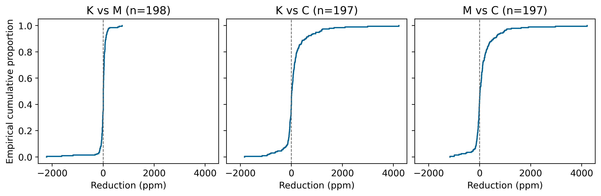

# Supplementary Methods and Statistical Checks

## S1 Recorded environment and build

**Table S1. Historical evidence for the 600-run environment.**

| Item | Recorded value |
| --- | --- |
| Host CPU | Intel Core Ultra 9 275HX, 24 cores and 24 logical processors. Same-host inventory dated 16 November 2026. |
| Physical RAM | 48 GiB installed in the host inventory. All 596 valid run receipts report 50,870,607,872 bytes (47.377 GiB) visible to Windows. |
| Operating system | Native Windows 11, build 10.0.26300, from the 20 November build receipt. |
| C compiler and target | w64devkit GCC 16.2.0, x86_64-w64-mingw32. |
| Main build flags | Common solver: `-O3 -std=gnu99 -fcommon -DTWO_LEVEL_TREE -march=native -ffp-contract=off`, forced Windows platform header, link `-lm`. The external bridge added `-ffunction-sections` and `-fdata-sections` to its two newly compiled units and linked with `-Wl,--gc-sections -lm`. |
| Logical affinity | Serial solver Job on logical CPU 0 (mask 1). Monitor on logical CPU 1. |
| Power and CPU state | All 596 valid admission receipts record AC power. Continuous supply status, active power plan, performance mode, and effective frequency during runs were not recorded. |

The same-host inventory also records the two installed modules (16 + 32 GiB). The compiler target appears in the 20 November compiler log. The original build has 175 baseline translation units. The relink receipt confirms the same flags for the replacements Ascent, AddTourCandidates and FindTour. The bridge receipt identifies its two newly compiled units as Distance.c and gpx_euc2d_io.c, alongside reused author objects. The 596 valid terminal receipts provide the run-time RAM, AC and affinity record. CPU affinity establishes logical placement. The records do not establish core type or exclusive access. The earlier hardware inventory is not evidence of the power plan or frequency during the formal run.

## S2 Common configuration and charged time

The three current arms and all parent runs share the frozen LKH 3.0.14-derived Windows build. C_ref starts without a supplied tour. The continuation arms install the selected initial tour on the first full TSP trial. Initial-tour edge insertion uses the registered normal setting. The main paper uses C, M and K as abbreviated labels. The frozen reference preserves visible historical P5/R4 settings and does not estimate the performance of an unconfigured or best-tuned LKH.

**Table S2. Common solver configuration.**

| Component | Registered setting |
| --- | --- |
| Distance model | TSPLIB EUC_2D, SCALE 1, PRECISION 100 |
| Candidate construction | POPMUSIC, maximum candidates 5, neighbors 5, sample size 10, solutions 25, trials 1, initial-tour construction off |
| Search configuration | Subgradient off, MOVE_TYPE 5, SUBSEQUENT_MOVE_TYPE 5, BACKTRACKING off, PATCHING_A 1, PATCHING_C 0, GAIN_CRITERION on |
| Limits | RUNS 1, MAX_TRIALS 100000, STOP_AT_OPTIMUM off, POPULATION_SIZE 0, TRACE_LEVEL 1 |
| Recombinations | Conditional internal GPX2 in the common solver. The K arm adds three external bridge invocations before continuation |
| Parent and arm clocks (s) | Request, stop proof, certification, cleanup at 17/18/19/20 for parents and 85/86/88/90 for each arm |
| Placement and protection | Native Windows, serial solver CPU0, independent monitor CPU1. Commit cap 4 GiB per process. Physical memory gates at 12 GiB for admission and 8 GiB during execution |

In the frozen author archive, LKHmain.c selects MergeWithTourGPX2 according to RECOMBINATION. RUNS = 1 precludes the Run > 1 branch, and POPULATION_SIZE = 0 precludes the MaxPopulationSize > 1 branch. The linked FindTour_ablation.c still permits trial-level merge attempts after the Lin–Kernighan step while both inner time bounds permit. The best-tour case requires FirstNode->BestSuc and a non-makespan setting. The ordinal-tour case requires Dimension = DimensionSaved, Cost ≥ OrdinalTourCost, BetterCost > OrdinalTourCost and a non-makespan setting. MergeWithTourGPX2 returns early if NewDimension = 0. A merge call therefore need not reach the internal gpx routine. Trace level 1 does not provide an invocation census. K’s P1/P2, P1/P3 and P2/P3 bridge processes and their verified child tours have individual records.

The 200 recorded pools share identical paid fees between M and K. Parent tour byte identities were checked for all 600 parent files. Continuation parameter files are identical within the 199 groups with a file for each arm. The M arm in the remaining group was blocked during admission and had no continuation parameter file. It retained the fee and pool identity in its result envelope.

**Table S3. Observed timing quantities.**

| Observed event or interval | Sample | Mean seconds | Range in seconds |
| --- | ---: | ---: | ---: |
| Full sealed pool fee paid by each arm | 200 pools | 51.394 | 51.160 to 51.487 |
| Three launches to observed Job-empty intervals, summed within K | 200 K arms | 0.131 | 0.094 to 0.191 |
| Three external calls' Job CPU time, summed within K | 200 K arms | 0.040 | 0 to 0.094 |
| Last external child verified, on the charged clock | 200 K arms | 53.042 | 52.751 to 53.241 |
| K minus M continuation launch on each arm's charged clock | 198 valid M/K pairs | 0.262 | 0.155 to 0.406 |

The field selection_s is retained in the frozen export. The portable numeric ledger names its exact value last_external_gpx_verified_charged_s. It is the last recorded child verification time from the arm’s charged origin. The elapsed process interval includes launch, operating-system and observation costs. The time between continuation launches includes all measured preparation differences. None of these fields alone identifies the effect of recombination time on the final tour.

Table S3 reports the source-verified quantities needed here. Section S4.3 explains the charging breakdown. The accompanying author evidence includes the pool and fee records and individual timing events. Its underlying materials follow the access conditions in the main paper.

## S3 Descriptive statistical checks

The same 196 complete C/M/K groups support the following common-coverage check across all 20 maps. The four incomplete groups remain represented in the delivery ledger. The main statistical analysis continues to use the eligible pairs for each contrast.

**Table S4. Common-coverage sensitivity among 196 complete triplets.**

| Comparison | Shorter / tied / longer | Map-equal ppm | 95% map-bootstrap interval, ppm |
| --- | --- | ---: | --- |
| K/M | 97 / 26 / 73 | −9.74 | [−43.44, +15.62] |
| K/C | 105 / 6 / 85 | +121.01 | [+61.04, +192.49] |
| M/C | 104 / 3 / 89 | +130.74 | [+56.35, +218.19] |

The K/M leave-one-map range is −14.02 to +3.34 ppm. The mean becomes positive only in the check omitting C10k.0. C10k.0 contributes −263.07 ppm across nine eligible pairs and includes the most negative pair (seed 981, −2,223.46 ppm). The registered result retains that instance and all its eligible pairs. The complete-group and leave-one-map results are sensitivity checks.

{width=95%}

The versioned public release provides the numeric tables and the statistical reproduction script. This supplement states the inference family below and gives the common-coverage and leave-one-map checks above. The separate Historical Appendix includes Tables H1–H9 and Figures H1–H3. The current paper's Table 3 and Figure 2 show the strata and map-level effects.

The original K/M primary result and the core-stage four-comparison snapshot are unchanged. The two p = 1 placeholders apply to that snapshot. The final analysis uses all four observed raw p values. See S5.2.

## S4 Original dispatch and cost audit

### S4.1 Execution order and environmental evidence

An independent replay of the original assignment with seed 20261120 reproduced all 800 frozen slot labels and all 600 executed C/M/K slots. Each map received five K-first and five M-first assignments. Two monitor exclusions left 99 valid K/M pairs per order. The K-first exclusion was C10k.0/2301, and the M-first exclusion was ei8246/981. Across the five controller epochs the total dispatch counts were 9, 33, 264, 19 and 275. All 596 valid root processes reported the expected parent PID for their epoch. No valid K/M pair crossed an epoch. C ran before the K/M block in 50 of 99 K-first pairs and 53 of 99 M-first pairs. The previously dispatched formal method was C in 72 and 74 cases, respectively. This predecessor is a scheduling observation. Pool construction and workloads outside the experiment can intervene. The median within-epoch delay between the first method completing and the next method entering was 0.0912 s and 0.0935 s, respectively. This interval uses a monotonic clock. It is distinct from the difference of 0.262 s between continuation launches on the arms' respective charged clocks.

Available memory, system commit, paging, AC admission, affinities and Job CPU time were logged. Continuous temperature and frequency, power limit transitions and total completed trials were not logged. The supplementary order comparisons therefore describe schedule sensitivity without attributing it to a physical mechanism. The full order sample remains in the primary K/M analysis. The disk-full ledger adjudication for slot 12 has no original terminal timestamp, which remains blank.

### S4.2 Identical starts and verified results

Independent SHA256 computations on 34 input tour files confirmed 17 byte-identical M/K starts. The 34 native first-trial witness tours were also independently parsed, normalized under rotation and reversal, and matched to their respective input cycles. Equal route length alone could not verify either claim. Across the 17 pairs, the engine, pool, seed and continuation parameter file matched within each pair. Fifteen pairs tied. On xvb13584, pool seed 1861, M and K ended at 37,103 and 37,104 with continuation seed 4861. With pool seed 2521, they ended at 37,121 and 37,122 with continuation seed 5521. The K continuation launch was 0.26784 s and 0.24316 s later on its charged clock, respectively. One pair was M-first, the other K-first. Each run met the predeclared stop-proof and delivery deadlines using the expected budget-stop exit status. These observations do not isolate the effect of launch delay or identify a search mechanism.

### S4.3 Measured costs and a future sensitivity protocol

The disjoint time segments sum to the reported final charge for all 596 valid arms. On the 198 matched M/K pairs, each method was charged the same mean parent-pool cost of 51.39493 s. K's three external bridge stages averaged 0.13091 s from launch to observed Job-zero and 0.08034 s from Job-zero to child verification. Other pre-launch work averaged 1.40854 s for M and 1.45971 s for K. The observed continuation intervals from launch to Job-zero averaged 32.21928 s for M and 31.95685 s for K. Candidate validation after native cleanup to scored delivery averaged 0.03961 s and 0.03926 s. Mean final charges were 85.23390 s and 85.23196 s. These intervals include the operations observed between each pair of timestamps. Monitor and Job CPU time overlap the wall-clock intervals, so they were not added again. The original 17 s limit was a stop-request setting per parent. The three requests account for a nominal 51 s, while the measured pool consumes about 57.1% of the 90 s ceiling.

A future budget study could use 12 fixed maps, three per stratum, and six prespecified seeds per map. Each configuration would assign equal numbers of K-first and M-first runs per map. A 30/90/300 s total-budget comparison could provision parent request settings of 5/17/56 s per parent, subject to a separately logged feasibility check for the 30 s budget. A 90 s allocation comparison could instead vary the parent request setting from three 17 s slots to three 10 s slots while preserving the same total cap. Each arm would pay its full pool cost, and K would additionally pay for recombination. Failures and tail observations would remain visible. The current experiment tested only the original 90 s allocation. The proposed sensitivity study has not been started.

**Table S5. Observed charges by phase, seconds (198 valid paired groups).**

| Phase | M | K |
| --- | ---: | ---: |
| Common pool | 51.39493 | 51.39493 |
| Other preparation before launch | 1.40854 | 1.45971 |
| External GPX2 launch to Job-zero | — | 0.13091 |
| Job-zero to child verification | — | 0.08034 |
| Continuation launch to observed Job-zero | 32.21928 | 31.95685 |
| Job-zero to native cleanup | 0.00329 | 0.00369 |
| Native cleanup to scored delivery | 0.03961 | 0.03926 |
| Delivery to charged completion | 0.16825 | 0.16628 |
| Total charge | 85.23390 | 85.23196 |

The disjoint ledger records the same wall time segments before the rounding used here. Job CPU time and monitor times overlap those intervals.

**Table S6. Largest negative K/M effects, ppm (exploratory).**

| Map/seed | Valid within map | Start | M / K own-start continuation | Final | Contribution to original primary mean |
| --- | ---: | ---: | ---: | ---: | ---: |
| C10k.0/981 | 9 | 81.06 | 2,797.31/499.06 | −2,223.46 | −12.35 |
| genC15k.seed100004/2521 | 10 | 43.13 | 1,831.92/163.20 | −1,628.59 | −8.14 |
| genC15k.seed100004/1861 | 10 | 39.71 | 2,600.45/1380.20 | −1,183.66 | −5.92 |

The registered all-pair map-equal estimate is −9.97555 ppm. The post hoc exclusion of absolute effects at or above 1,000 ppm gives +18.73239 ppm. This exclusion is solely a sensitivity check. The three effects and all other valid pairs remain in the primary estimate.

The exploratory map sign-flip enumerated all 1,048,576 combinations, included ties at the observed magnitude using a 10⁻⁹ ppm sum tolerance and had no zero map differences. The conditional within-map label check used 100,000 draws and a plus-one numerator and denominator. Map bootstrap intervals, within-order strata, order-standardized estimates, common-triplet results and tail/leave-one-map checks are descriptive or sensitivity analyses, without multiplicity-adjusted post hoc inference.

## S5 Independent follow-up series

R13a01 checked the saved request timestamp and accepted 78 of 79 terminal attempts. R13a02 checked the native termination call and ordered Job evidence, accepting 121 of 121. Both retained the 85/86/88/90 s boundaries. The original stop-evidence rule (a01) accepts exactly the 199 officially scored runs on replay of all 200 archived attempts. All 121 a02 attempts pass both rules. The a02 counterfactual accepts e0316, whose official record remains a failure with no score. The revised check was applied after the timed run. The native solver, search parameters, budget and candidate consumption were the same in both phases.

EAX ran in a later time block, 21 November 2026 13:47:30–19:21:31 Beijing time (UTC+08:00). All 200 dispatched attempts reached terminal status. Independent verification confirmed the 199 scored routes. The e0316 evidence failure remains in the ledger without a score. The a02 rule was introduced for the 121 slots that had not yet been dispatched at the time of the revision. It changed only the post-run adjudication of stop evidence. It compares the recorded termination call with the original 85 s threshold and retains the requirements for stop proof before 86 s, certification before 88 s, and cleanup before 90 s. The native EAX x64 binary, charged work and deadlines stayed fixed.

The M/EAX and K/EAX contrasts each use 198 valid matched pairs across 20 maps. The EAX length is the denominator, and positive ppm favors the named LKH arm. Resampling complete maps gives the reported 95% percentile intervals. Each EAX contrast has final four-contrast Holm p = 0.000206. The auxiliary EAX-only Holm adjustment gives p = 0.000103 per contrast. This two-contrast family was not separately preregistered. Figure S2 shows how the paired mean differences vary across the fixed panel. The public release supplies the numerical map effects and the English companion audit. Detailed terminal and version evidence follows the access conditions in the main paper.

The registered native protocol used a 64-bit EAX build, with population size Npop = 100 and Nch = 30 generated offspring per crossover call. Each native process received the single-trial argument. If a child finished naturally before the request deadline, the wrapper could restart within the same charged clock. The native solver and wrapper shared logical CPU0. The resource sampler ran on CPU1. The request target was 85 s within the 90 s envelope, with proof, certification and cleanup cutoffs below 86, 88 and 90 s respectively. The saved record separates observed termination and candidate publication from unobserved solver internals.

The pair key is the map and the preregistered group seed label s. M and K share parents seeded s, s + 1000 and s + 2000 and continue with s + 3000. The initial EAX child receives s. Its zero-based child index j uses s + 100000j, including after a restart. Group labels match planned replicates across workflows. The algorithms use separate random-number streams.

The native executable was a project-adapted Windows x86-64 build of [GA-EAX 1.0 Normal](https://github.com/nagata-yuichi/GA-EAX/tree/015dfbe9f267230f78787bd244af393ffc018900/GA_EAX_1.0/Normal) (upstream commit `015dfbe9f267230f78787bd244af393ffc018900`). The build manifest records w64devkit `g++` (GCC) 16.2.0 and `-O3 -std=gnu++11 -static -Wformat=2`. Adaptations covered explicit seeding and Windows RNG compatibility, candidate export, 64-bit tour arithmetic, bounds and segment bookkeeping, and signed-decimal EUC_2D input validation. The native executable SHA256 is `db5e3f8d938aeb22d2d7d09a9218256b6e061b2c0149cf94e950bb407cff65a9`. The pinned upstream source is public. The adapted source and experimental executable require authorized access. An independent bit-for-bit rebuild has not been verified.

The observer parsed decimals exactly into integer coordinate grids, checked candidate feasibility and recomputed integer EUC_2D length. The candidate-processing path calculated SHA-256 and wrote extra snapshot and committed copies when the independently certified incumbent improved. The 199 valid runs produced and consumed 217,679 candidates (529–1,573 per run, median 1,066). The C10k.0, C10k.1 and C10k.2 ranges were 1,481–1,561, 1,501–1,557 and 1,523–1,573. The whole-wrapper charge includes observation, validation, saves and process coordination. For 199 valid runs, its charged CPU median was 13.23 s (9.41–17.48 s). The median native child CPU time was 68.781 s and the external sampler median was 0.36 CPU s. Each median summarizes its own measurement series. A sum of component medians gives neither the median run-level total nor a wall-clock budget. Charged cleanup wall time was 85.12–85.64 s. Outer controller total wall time had a median of 97.33 s and includes administrative work around the charged task. These measurements overlap and differ in scope. No wrapper-free comparison or isolated exclusive observer wall time was measured.

The observer recorded at least one improving candidate committed with a charged delivery time of 80 s or later in 176 of 199 valid runs and all 79 valid runs in the larger-size group. Native discovery, file publication and strict certification are distinct events. The medians for the first native-clock genetic incumbent below 12,000 cities and at 12,000 cities or more were 9.99 and 19.25 s, with median last-improvement generations of 1,258.5 and 888. These counters describe observed work. They do not measure how many more generations would have been needed to achieve a particular tour or isolate a cause of the size association.

{width=100%}

**Table S7. Native EAX process counts and descriptive matched-pair results.**

| Native children per attempt | Attempts / valid | Maps | Pairs per contrast | M/EAX shorter / tied / longer; ppm | K/EAX shorter / tied / longer; ppm |
| ---: | ---: | ---: | ---: | --- | --- |
| 1 | 180 / 179 | 18 | 178 | 158/1/19; +26,724.31 | 161/2/15; +26,700.74 |
| 2 | 20 / 20 | 2 | 20 | 1/1/18; −216.30 | 3/1/16; −219.66 |

Each of the 20 two-child attempts recorded one natural trial finish followed by one restart. Each of dga9698 and xmc10150 accounted for 10 attempts. The other maps had no restarts. The one-child group includes the e0316 evidence failure, which contributes no score. The ppm column gives map-equal means, with positive values favoring the LKH workflow. This post hoc grouping exactly tracks two selected VLSI maps versus the other maps. It supports no causal restart effect and leaves the overall estimates and p values unchanged.

### S5.1 Fixed-start continuation run rules

After inspecting the primary K/M results, we chose the three most negative outcomes: C10k.0/981, genC15k.seed100004/2521 and genC15k.seed100004/1861. The last two pools share one map. In each pool, both historical starts were continued with each of 20 new paired seeds. The 120 attempts yielded 60 valid pairs. These selected starts cannot represent the distribution of other pools or maps. The diagnostic cannot distinguish effects of GPX2 structure, timing, thermal conditions or another mechanism. The separate 800-slot mechanism-diagnostic plan remains deferred.

| Component | Recorded rule |
| --- | --- |
| Implementation | The primary batch's LKH 3.0.14 Windows continuation build and search options (Table S2), compiled with GCC 16.2.0 w64devkit. The solver used logical CPU0 and the resource sampler used CPU1. |
| Starts and seeds | Install verified stored tours with `INITIAL_TOUR_FILE=start.tour` and `INITIAL_TOUR_FRACTION=1`. The plan derives 20 new seeds via SHA-256. Each pairs the two starts, ten per order in each pool. |
| Charged window | The monotonic clock starts at arm entry. It includes input and start checks, copies, setup, search, monitoring, certification, handoff and cleanup. Historical pool generation and start selection are outside the window. |
| Deadlines | Stop request at 27.6 s, exit proof before 28 s, certified delivery before 29 s and cleanup before 30 s. |
| Charged completion | 27.7333–28.0361 s after entry, observed after handoff and cleanup. The full-window limit is 30 s. |

Continuation-binary SHA-256: `d239bf79873b085ae2d246812b0237af74f6d6b97c413490ea9ac9f8b295d665`.

### S5.2 Statistical specifications and numerical replay

The protocol was internally frozen and hash-bound before execution; it was not deposited in an external public preregistration registry. The final secondary inference follows the prespecified four-comparison family. Applying Holm to the four observed raw p values gives 0.000206 for K/C, K/EAX and M/EAX and 0.000561 for M/C. Table 2 preserves the core-stage snapshot (K/C 0.000252; M/C 0.001682), with the two unavailable EAX results entering the adjustment as p = 1. The later report’s EAX-only adjustment, p = 0.000103 for each contrast, is supplementary. No pre-execution contract specified a separate two-contrast family. The analysis retains the cross-period design and the original pairings.

All effects use 10⁶ × (reference length − test length) / reference length. Positive ppm favors the test arm. Equal verified integer lengths count as ties. Quality calculations require a valid outcome from each arm in the relevant pair. Missing or invalid deliveries remain in the delivery accounting.

**Table S8. Pairing, estimands and resampling.**

| Series | Pairing, reference, and analysis unit | 95% percentile interval |
| --- | --- | --- |
| Primary 600 | Map and original seed. Reference M for K/M and C for K/C or M/C. Average valid pairs within maps, then weight maps equally. | Resample map means 100,000 times with replacement. Restart Python's random generator with seed 20261120 for each contrast. |
| Later EAX 200 | Map and original seed. Match valid EAX with valid M or K using the map and group seed label. Reference EAX. Equal map weights. e0316 affects delivery only. | Same whole-map resampling and independently reset Python seed per contrast. |
| Fixed-start 120 | Selected pool and new seed. Reference M. Pair seeds and summarize each pool and its two order groups separately. | Resample paired effects in each cell 10,000 times with `Random.choices` at the observed cell size. Use seeds 20261121–20261123 in pool order above and 20261125–20261130 for order cells, M first then K first per pool. |

**Table S9. Tests and multiplicity.**

| Series | Test and multiplicity |
| --- | --- |
| Primary 600 | Preregistered primary K/M. Exact two-sided rational sign flips include equal absolute effects. Zero terms do not affect the probability. The four secondary Holm entries are K/C, M/C and two EAX p = 1 placeholders. |
| Later EAX 200 | Separate follow-up. All 2²⁰ rational sign patterns, two-sided and inclusive of equality. Use the two observed EAX raw p values in the final four-contrast adjustment. The EAX-only adjustment is supplementary. |
| Fixed-start 120 | Post hoc pool selection. Conditional descriptive intervals per pool, without a pooled map effect, null test or Holm adjustment. |

All percentile intervals use linear interpolation at (B−1)q in the sorted B draws for q = 0.025 and 0.975. Sign tests assume map-sign exchangeability. For the EAX replay, the raw and adjusted p-value fields are `two_sided_exact_signflip_p` and `supplementary_holm_two_contrasts`.

The [versioned public baseline](https://github.com/wang-d-c/TSP-CMK-Corresponding-Author-Final-Review-20261121/releases/tag/cmk-final-science-20261122) contains the English follow-up audit, map-wise numerical results, the conditional summary and portable analysis files. Author-controlled raw operational evidence and restricted native artifacts require separate authorized access.

### S5.3 Sensitivity to the EAX stop-evidence check

The a01 rule by itself reproduces the 199 official EAX deliveries and 198 pairs per contrast. The a02 rule gives the same figures when the frozen e0316 failure is retained. The sole rule difference is whether the saved preparation timestamp or native termination call must meet the 85 s lower bound. Under the later check, the archived candidate from e0316 passes the counterfactual replay. Its independently recounted length is used only in the following sensitivity rows.

| Counterfactual check on all endpoints | EAX deliveries | Pairs | Map-equal ppm | 95% map-bootstrap interval, ppm | Auxiliary two-contrast Holm p |
| --- | ---: | ---: | ---: | --- | ---: |
| Later rule, M/EAX | 200 | 199 | +24,017.41 | [+6,750.64, +50,815.90] | 0.000103 |
| Later rule, K/EAX | 200 | 199 | +23,995.73 | [+6,730.79, +50,791.18] | 0.000103 |

The comparison uses the same map and seed joins, bootstrap and exact tests as the reported follow-up. The first dispatch remains failed in the official results. The full stop-check and descriptive run-order tables are in the EAX audit in this release.
