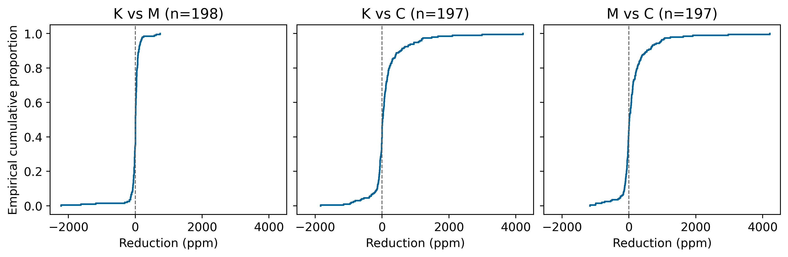
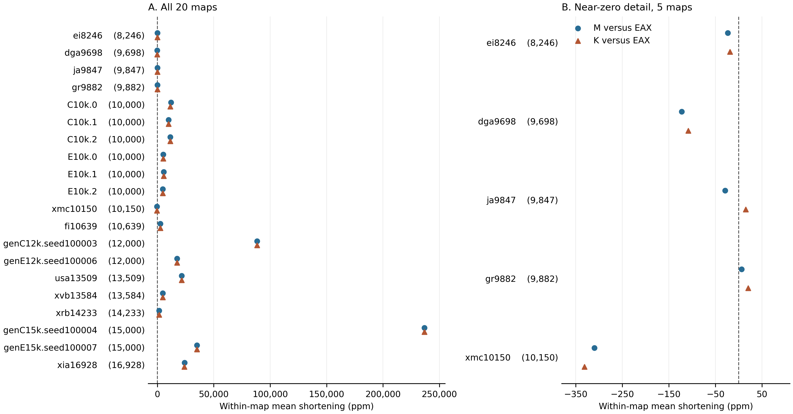

# 方法与统计补充 中文审阅稿

本稿对应英文 Supplement 的 S1–S5。保留相同的图号、效应方向和关键数值。详细编译参数、完整表 S1–S6 和推断定义见同版英文补充。

## S1 环境与构建

原 600 项在 Windows 11（构建 10.0.26300）上运行。宿主清单记录 Intel Core Ultra 9 275HX 和 48 GiB 物理内存。596 条有效回执记录 Windows 可见内存 50,870,607,872 字节（47.377 GiB）。本机求解绑定逻辑 CPU 0，监控绑定逻辑 CPU 1。有效准入回执记录交流电供电。实验未连续记录电源状态、性能模式或有效频率。逻辑 CPU 亲和记录不证明独占或核类型。编译器为 w64devkit GCC 16.2.0，目标为 x86_64-w64-mingw32。

## S2 共同配置与计费

C、M、K 和父路线运行使用冻结的 Windows LKH 3.0.14 派生构建。三臂均使用 TSPLIB EUC_2D。计费包括生成和选用父路线、重组、核验与交付等实际工作。M、K 全额承担相同父池费用。K 对三对父路线各调用一次外部 GPX2 桥接。共同构建的内部路径仍可在满足冻结条件时尝试 GPX2 合并。M 与 K 的比较针对三次额外外部调用的净作用。

| 观测指标 | 样本 | 平均秒数 | 范围（秒） |
| --- | --- | ---: | ---: |
| 每臂支付的完整共同父池费用 | 200 个池 | 51.394 | 51.160–51.487 |
| K 的三次启动至观测到 Job 空状态的总时段 | 200 项 K | 0.131 | 0.094–0.191 |
| K 的三次外部调用 Job CPU 时间总和 | 200 项 K | 0.040 | 0–0.094 |
| 最后外部子任务核验时间（计费时钟） | 200 项 K | 53.042 | 52.751–53.241 |
| K 减 M 的续搜启动计费时差 | 198 个有效 M/K 配对 | 0.262 | 0.155–0.406 |

## S3 描述性统计检查

三臂都完整的 196 组结果覆盖 20 张图。主结果保持依各比较的有效配对计算。

| 比较 | 短／平／长 | 地图等权 ppm | 95% 地图重抽样区间 ppm |
| --- | --- | ---: | --- |
| K/M | 97／26／73 | −9.74 | [−43.44, +15.62] |
| K/C | 105／6／85 | +121.01 | [+61.04, +192.49] |
| M/C | 104／3／89 | +130.74 | [+56.35, +218.19] |

K/M 留一图后的效应范围为 −14.02 至 +3.34 ppm，只有去掉 C10k.0 时点估计转为正值。原分析保留该图及全部有效配对。600 项的原四项次要 Holm 家族仍保留。同期没有 K/EAX 和 M/EAX 数据，两个 p = 1 占位只适用于该原家族。EAX 后补验使用独立两项检验家族。

{width=95%}

## S4 派发与成本审计

### S4.1 执行顺序与环境证据

原派发重放重现 800 个槽位标签和全部 600 个已执行 C/M/K 槽位。每图各分配五个 K 先和五个 M 先配对。两项监控排除后，两种处理顺序各有 99 个有效 K/M 配对。温度、频率和已完成的全部试跑数没有连续记录。顺序比较只描述记录到的敏感性。

### S4.2 相同起点与已核验结果

独立 SHA256 对 34 个输入文件确认 17 组逐字节相同的起点。核验程序还检查了原生首轮见证路线与其输入是否为同一环。15 组交付路线等长。xvb13584 的另两组 K 路线都比 M 长 1 个单位。两组在 K 与 M 各自的计费时钟上，K 分别晚 0.26784 和 0.24316 秒进入续搜。现有记录不足以识别时差的单独效应。

### S4.3 计费阶段与敏感性方案

198 个有效 M/K 配对中，两臂共同的父池平均费用为 51.39493 秒。M 和 K 从续搜启动到观测到 Job 空状态的平均时段分别为 32.21928 秒和 31.95685 秒。平均最终计费为 85.23390 秒和 85.23196 秒。CPU 时间与墙钟时段可重叠。候选的预算敏感性方案仍未运行。原主要 K/M 均值为 −9.97555 ppm；排除绝对效应达 1,000 ppm 的配对只作事后敏感性检查，原估计保留所有有效配对。

## S5 独立补验

EAX 在后续独立时段执行。200 项都有终态，199 条路线通过核验，e0316 的证据失败保留为空分。M/EAX 与 K/EAX 各使用 20 张图和 198 对有效配对，地图等权均值分别为 +24,030.25 ppm（95% 区间 [+6,763.64, +50,836.32]）与 +24,008.70 ppm（[+6,742.41, +50,802.43]）。两项后续检验经 Holm 校正后均为 p = 0.000103。

EAX 配置为 Npop = 100、Nch = 30。原生求解和包装在同一逻辑核心上运行，观察器参与核验。199 个有效运行共产生并处理 217,679 个候选，每项 529–1,573 个，中位数 1,066 个。计费包装进程 CPU 时间中位数为 13.23 秒（范围 9.41–17.48 秒）。176 项在计费第 80 秒或以后仍有经处理和写入记录的改进，其中包括较大规模组的 79 项。各 CPU 项的中位数和墙钟预算采用不同计量口径。晚期记录不等于原生发现时刻，也不足以证明更长预算会改变相对结果。

{width=100%}

### S5.1 固定起点续搜的运行规则

在看到主批次 K/M 结果后，选取结果最负的三个父池，分别是 C10k.0/981、genC15k.seed100004/2521 和 genC15k.seed100004/1861。后两个父池属于同一张图。各池的两个历史起点使用相同的 20 个新续搜种子。120 项形成 60 个有效配对。所选起点不能代表其他父池或地图的结果分布，诊断也不能分辨 GPX2 结构、时间差、热状态及其他机制的影响。原 800 项机制协议仍暂缓。

| 项目 | 原记录中的规则 |
| --- | --- |
| 实现 | 使用主批次的 LKH 3.0.14 Windows 续搜构建和搜索参数（表 S2），GCC 16.2.0 w64devkit 编译。原生求解使用逻辑 CPU0，资源采样使用 CPU1。 |
| 起点和种子 | 独立核验既有起点后，以 `INITIAL_TOUR_FILE=start.tour` 和 `INITIAL_TOUR_FRACTION=1` 安装。计划通过 SHA-256 生成 20 个新种子，各池按同种子配对两个起点，每种顺序各 10 对。 |
| 计费窗口 | 单调计时从进入该臂开始，早于输入检查与本地准备。计入验图验起点、复制、准备、原生搜索、资源监测、路线认证、交付和清理。历史父池生成与起点选取在窗口之外。 |
| 截止时点 | 27.6 秒请求停搜，28 秒前取得退出证明，29 秒前认证交付，30 秒前清理。 |
| 实际计费结束 | 120 项的实际计费结束时刻为从进入该臂起 27.7333 至 28.0361 秒，在交付和清理之后记录。30 秒是整个窗口的上限。 |

续搜二进制 SHA-256 为 `d239bf79873b085ae2d246812b0237af74f6d6b97c413490ea9ac9f8b295d665`。

### S5.2 统计规格与数值复算

效应为 10⁶ ×（参照路线长度 − 待比较路线长度）／参照路线长度，正 ppm 有利于待比较方法。核验后的整数路线长度相等记为平局。质量只使用比较所需的两条路线均有效的配对。缺失和无效交付保留在交付统计中。

| 批次 | 配对键、分母和分析单位 | 95% 百分位区间 | 检验与多重比较 |
| --- | --- | --- | --- |
| 主批 600 项 | 按图及原种子配对。K/M 以 M 为分母，K/C、M/C 以 C 为分母。先算图内有效配对均值，再按地图等权。 | 将整张图的均值有放回抽样 100,000 次。每个比较分别初始化 Python `random.Random(20261120)`。 | 原登记的 K/M 为主要检验。地图有理数均值做精确双侧符号翻转，绝对效应等于观测值计入尾部，零值不改变精确概率。原四项次要 Holm 家族为 K/C、M/C 和原冻结的两个 EAX p = 1 占位。 |
| 后补 EAX 200 项 | 将有效 EAX 结果与主批次有效 M 或 K 按图及原种子配对，以 EAX 为分母，按地图等权。e0316 仅计交付状态。 | 同主批次按整张图重抽样，每个比较分别初始化随机数生成器。 | 独立补验。对全部 2²⁰ 种有理数符号组合做双侧精确检验，绝对效应等于观测值的情形计入。Holm 只校正 M/EAX、K/EAX。 |
| 固定起点 120 项 | 按所选父池及新续搜种子配对，以 M 为分母。按池分别汇总，顺序汇总只在对应池和顺序内进行。 | 对每池或顺序单元用 Python `Random.choices` 有放回抽取配对效应，按单元观测样本量重抽样 10,000 次。按上文父池顺序使用 20261121 至 20261123；顺序单元采用 20261125 至 20261130，各池先 M 先、后 K 先。 | 父池属事后选择，区间为条件性描述。没有合并的地图效应、零假设检验或 Holm 校正。 |

区间在排序后的 B 个重抽样统计量中，以从零计的索引 (B−1)q 对 2.5% 和 97.5% 分位数线性插值。地图级检验依赖符号可交换假设。EAX 输出中原始和校正后 p 值的字段分别是 `two_sided_exact_signflip_p` 与 `supplementary_holm_two_contrasts`。

[当前固定版本发布](https://github.com/wang-d-c/TSP-CMK-Corresponding-Author-Final-Review-20261121/releases/tag/cmk-reviewer-fixes-20261122)提供英文补验审计、按地图的数值结果、条件续搜摘要和独立复算材料。作者受控原始运行证据和受限原生材料另需授权。
